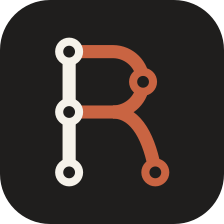
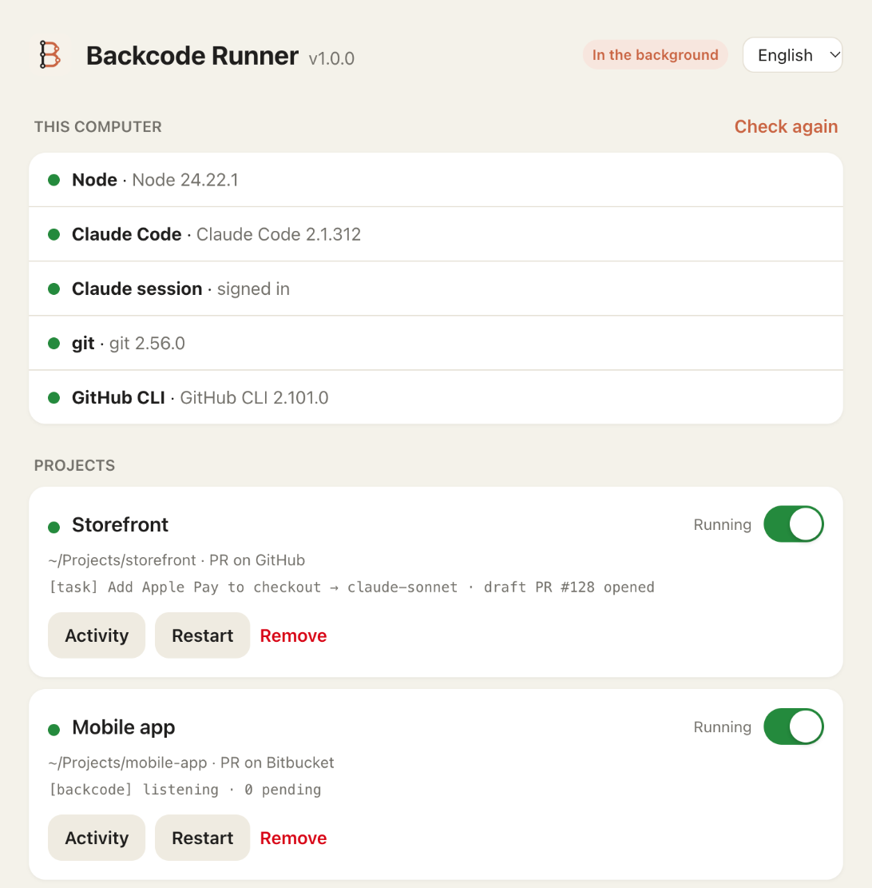
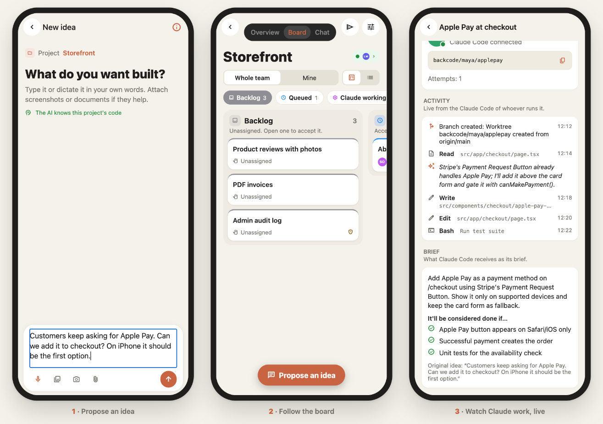
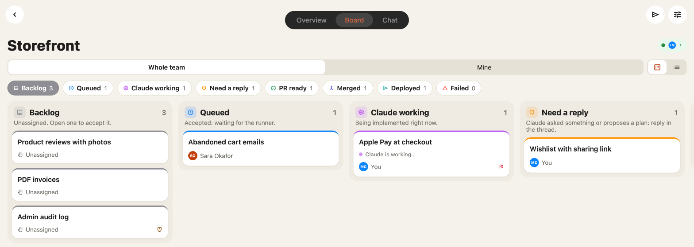
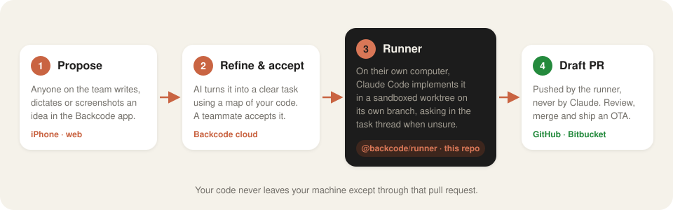

<p align="center">
  
</p>

<h1 align="center">Backcode Runner</h1>

<p align="center">
  <strong>Your team's backlog, implemented by Claude Code, on your own machine.</strong><br>
  The local runner for <a href="#what-is-backcode">Backcode</a>: it picks up the tasks you accept in the app, has Claude Code build them on their own branch and opens a draft pull request.
</p>

<p align="center">
  <a href="https://www.npmjs.com/package/backcode"></a>
  <a href="https://www.npmjs.com/package/backcode"></a>
  <a href="https://github.com/hernanmateo/backcode-runner/actions/workflows/ci.yml"></a>
  <a href="LICENSE"></a>
  <a href="https://github.com/hernanmateo/backcode-runner/releases/latest"></a>
  
  
  
  <a href="https://docs.claude.com/claude-code"></a>
  <a href="CONTRIBUTING.md"></a>
</p>

<p align="center">
  <a href="https://backcode-626c6.web.app"></a>
  <!-- App Store y Google Play: badges cuando la app sea pública -->
</p>

<p align="center">
  <a href="#quick-start">Quick start</a> ·
  <a href="#install">Install</a> ·
  <a href="#how-it-works">How it works</a> ·
  <a href="#the-panel">The panel</a> ·
  <a href="#security">Security</a> ·
  <a href="#faq">FAQ</a> ·
  <a href="README.es.md">Leer en español</a>
</p>

<br>

<p align="center">
  
</p>

## Quick start

<p>
  <a href="https://github.com/hernanmateo/backcode-runner/releases/latest/download/Backcode-Runner.dmg"></a>
</p>

**On a Mac, that's it:** open the `.dmg`, drag **Backcode Runner** to Applications and open it. No Terminal, no Node. It installs
the runner, sets it to start at login and opens its panel in your browser.

In the panel:

1. **This computer.** Anything missing turns into a step-by-step guide with a button that does it: install Claude Code, sign
   in to Claude (or paste an Anthropic API key), **Connect with GitHub** (an 8-character code in your browser, no Terminal) and
   install git or GitHub CLI if needed.
2. **Connect a project.** In the Backcode app: **Project → Connect step by step → Copy configuration**, then **Paste
   configuration** in the panel. The runner finds the repo on your computer (or clones it into `~/Backcode/<project>` with one
   click) and starts. Your next task becomes a draft pull request.

**You need:** macOS or Linux, and [Claude Code](https://docs.claude.com/claude-code) with a Pro or Max plan (or an API key).
The panel sets up everything else.

## Install

Every option installs the same runner and opens the same panel. Pick the one that suits you.

| | How | Best for |
|---|---|---|
| **🍎 Mac app** · *easiest* | [Download Backcode-Runner.dmg](https://github.com/hernanmateo/backcode-runner/releases/latest/download/Backcode-Runner.dmg), drag it to Applications, open it | Anyone on macOS. No Terminal, no Node |
| **⚡ One command** | `curl -fsSL https://raw.githubusercontent.com/hernanmateo/backcode-runner/main/install.sh \| sh` | Linux, or the Terminal on a Mac. No Node |
| **📦 npm, no install** | `npx backcode` | You already use Node 22+ |
| **📦 npm, global** | `npm install -g backcode`, then `backcode` | Node users who want the command around |
| **🤖 Claude Code plugin** | In Claude Code: `/plugin marketplace add hernanmateo/backcode-runner`, `/plugin install backcode@backcode`, then `/backcode:setup` | You live in Claude Code: it installs, connects and fixes everything with you |
| **🛠️ From source** | `git clone https://github.com/hernanmateo/backcode-runner && cd backcode-runner && npm install && npm run panel` | Contributors |

<details>
<summary><strong>More options</strong></summary>
<br>

- **A specific version:** `curl -fsSL https://raw.githubusercontent.com/hernanmateo/backcode-runner/main/install.sh | BACKCODE_VERSION=1.0.0 sh`,
  or `npx backcode@1.0.0`.
- **Install without opening the panel:** `… | BACKCODE_NO_OPEN=1 sh`.
- **Just the executable:** download `backcode-<os>-<arch>` from the [latest release](https://github.com/hernanmateo/backcode-runner/releases/latest)
  (`darwin-arm64`, `darwin-x64`, `linux-x64`, `linux-arm64`), check it against `SHA256SUMS` and run it.
- **Headless (servers, no browser):** `backcode connect` to paste the configuration in the terminal, `backcode service install`
  to keep it running, `backcode start` to run it in the foreground.
- **Everything in another folder:** set `BACKCODE_HOME` (default `~/.backcode`) and `BACKCODE_PANEL_PORT` (default `47474`).

</details>

<details>
<summary><strong>Uninstall</strong></summary>
<br>

1. Run `backcode service uninstall` (stops the service and removes it).
2. Delete **Backcode Runner** from Applications (if you used the Mac app), and the folder `~/.backcode`.
3. If you used `install.sh`, remove the `# Backcode runner` line it added to your shell profile (`~/.zshrc`, `~/.bash_profile`…).
4. With npm: `npm uninstall -g backcode`.

</details>

## What is Backcode?

Backcode is a backlog for teams that build with Claude Code. Anyone on the team proposes ideas from their phone, typed,
dictated or with screenshots and PDFs. An AI turns each one into a clear brief using a map of your codebase, flags security
risks and suggests a model. Whoever accepts a task runs it **on their own Claude Code, on their own computer**, and gets a
**draft pull request**.

This repository is the part that runs on your computer. It's open source so you can read exactly what it does with your code.

<p align="center">
  
</p>

<p align="center">
  
  <br><sub>The same app on iPhone and on the web (<a href="https://backcode-626c6.web.app">open it</a>). Screenshots from a demo project.</sub>
</p>

## How it works

<p align="center">
  
</p>

For every task you accept, the runner:

1. **Claims it** and checks that it's yours, that you're still in the group and that the brief hasn't changed since you accepted it.
2. **Creates an isolated worktree** on its own branch (`backcode/<you>/<task>`) from the latest base branch. Your working copy is never touched.
3. **Runs Claude Code** with the brief and its attachments, sandboxed to that worktree. If something essential is unclear, Claude
   **asks in the task thread** and the same session continues with your answer. With **plan mode**, it first proposes a plan
   (read-only) that you refine and approve.
4. **Reviews the result** (protected paths, secrets in the diff), commits, pushes and opens a **draft PR**. Claude never pushes.
5. **Reports live** to the app: what Claude says, the commands it runs, the files it touches, cost and tokens.

It also handles what an admin asks for from the app, always with your own credentials: merge a PR once checks are green,
publish an **Expo OTA update** (after a boot test in a simulator), build for TestFlight / Internal Testing, **install the app on your own phone** (Release build of the main branch, over Wi-Fi or
cable, on a phone paired with your runner's computer; the panel's **Phones** section shows which ones are ready) — or a
**development version** that loads the code instantly from your runner's Metro: the main branch, or any task with "Try on my
phone" on its page — or run a deploy script. A **Pending deploys** card lists what's on the main branch and hasn't gone out yet, as numbered steps in
the right order (rules → functions → other deploys → OTA), each with its own button plus **Deploy everything**, which stops at the
first failure. Deploys are
`backcode:deploy:<name>` scripts in any `package.json`, plus what the runner detects by itself: Cloudflare Workers (and their D1
migrations), Supabase (migrations and edge functions) and Firebase (rules and functions); the “i” next to each one says what to
check if it fails (signing in to wrangler, supabase, firebase…).

## Features

<table>
  <tr>
    <td width="50%" valign="top">
      <h4>Zero-terminal setup</h4>
      A local panel with machine checks, paste-to-connect, per-project switches, live activity and <em>Start at login</em>.
    </td>
    <td width="50%" valign="top">
      <h4>Your subscription, your machine</h4>
      Uses the Claude Code you're already signed into (Pro or Max included). Your code only leaves through the PR.
    </td>
  </tr>
  <tr>
    <td valign="top">
      <h4>Sandboxed by default</h4>
      OS sandbox, worktree-only writes, network allowlist, no secrets in the environment, guarded commands and protected paths.
    </td>
    <td valign="top">
      <h4>Conversations, not one-shots</h4>
      Claude asks in the task thread, you answer from your phone, the same session continues and the same PR updates. Watch it <b>live</b> and write to it while it works, stop it, or open the session in the Claude app (Remote Control) and hand it back.
    </td>
  </tr>
  <tr>
    <td valign="top">
      <h4>GitHub and Bitbucket</h4>
      Draft PRs with <code>gh</code> or a Bitbucket API token, or just push the branch. Detects merges and conflicts with main.
    </td>
    <td valign="top">
      <h4>New projects from an idea</h4>
      Describe a project in the app: your runner creates the folder and the GitHub or Bitbucket repo with your credentials, connects it and builds the first task as a draft PR.
    </td>
  </tr>
  <tr>
    <td valign="top">
      <h4>Ship from the app</h4>
      Merge with green checks, Expo OTA (EAS Update or your own script) with a boot test, store builds and monorepo deploys.
    </td>
    <td valign="top">
      <h4>Always up to date</h4>
      Installs new versions by itself (verified with SHA-256) and restarts each runner only when it's idle. A task in progress is never interrupted.
    </td>
  </tr>
  <tr>
    <td valign="top">
      <h4>Speaks your language</h4>
      Panel, terminal and Claude's messages in English, Spanish or Catalan, following your profile in the app.
    </td>
    <td valign="top"></td>
  </tr>
</table>

## Claude Code plugin

Prefer to do it from Claude Code? The `backcode` plugin sets everything up with you, conversationally:

```text
/plugin marketplace add hernanmateo/backcode-runner
/plugin install backcode@backcode
/backcode:setup
```

Everyone installs it once in their own Claude Code. The marketplace is read from the public `hernanmateo/backcode-runner` repo:
if that repo goes private, it stops working for anyone without access, and the marketplace (`.claude-plugin/` and `plugins/`)
would have to be published from a public repo, such as the releases one.

- **`/backcode:setup`** checks your computer, installs the runner, helps you sign in to GitHub, connects the project (the
  configuration goes from your clipboard straight to the runner, never through the chat), finds or clones the repo and keeps it
  running at login.
- **`/backcode:doctor`** finds out why a project is stuck, tasks don't start or PRs don't open, and fixes it.

It drives the same `backcode` commands you can run yourself (`backcode status`, `backcode connect --clone --no-start`…).

### Backcode guidelines outside Backcode

An admin chooses in the app (**Edit project › Backcode guidelines outside Backcode**) how people work on the repo with Claude
Code directly, through the plugin:

- **Off**: Claude Code works as usual.
- **Remind**: at the start of every session in that repo (or one of its worktrees), Claude gets the guidelines: every feature or
  fix in its own worktree and branch from the up-to-date base, and the main branch only through a PR.
- **Require**: on top of that, a `git commit` on the main branch or a `git push` that updates it (`main`, `HEAD:main`, `--all`…)
  asks for confirmation first. It asks rather than blocks: some cases are legitimate (publishing a release, for example).

For the work itself, **`/backcode:feature`**, or by hand:

- `backcode task start "<title>"`: a worktree in `~/.backcode/worktrees/<project>/<id>` on `backcode/<handle>/<id>`, from a
  freshly fetched `<remote>/<base>`, with your local `.env` files copied.
- `backcode task pr --title "…" --body-file pr.md` (from that worktree): checks for uncommitted changes and secrets, pushes the
  branch, opens (or updates) the PR and **puts it on the board** as your task in “PR ready”, ready to merge and deploy from the
  app. The runner doesn't continue it (it doesn't have its session): keep working in the worktree and `backcode task pr` updates
  the same PR.

The hook never reads your configuration (it holds keys): each runner leaves only the project name, repo path, base branch,
remote and mode in `~/.backcode/guard/<project>.json`, and `backcode hook session-start|pre-tool-use` decides from that. Without a
runner (or with an older one), the plugin does nothing. It only acts inside Claude Code: to make the main branch reachable only
through PRs from anywhere, turn on branch protection in GitHub or Bitbucket (the app links to the settings in Require mode).

## The panel

Open the Mac app, run `backcode` or `npx backcode`; it opens at `http://127.0.0.1:47474`:

| Section | What you can do |
|---|---|
| **This computer** | See whether Claude Code and its session, git and GitHub CLI are ready. Anything missing opens a step-by-step guide with a button that fixes it (official Claude Code installer, Claude sign-in or an Anthropic API key, **Connect with GitHub** with a code in the browser, official GitHub CLI, Xcode tools) and the command if you'd rather do it yourself. |
| **Projects** | Turn each project on or off (remembered across restarts), restart it, watch its live activity or remove it. |
| **Connect a project** | Paste the configuration from the app. It validates your key, finds the repo on your computer by its remote (in the usual folders, `~/apps` included, and next to your other connected projects), or clones it into `~/Backcode/<project>` or lets you pick a folder (in the terminal, answer “n” and type its path) and asks for a Bitbucket token when needed. |
| **Accounts** | See your `gh` sign-in and add, check or change your Bitbucket API token, used for every project and to create new repos from the app (add the `admin:repository:bitbucket` scope for that). |
| **Start at login** | Installs the runner as a user service (launchd on macOS, `systemd --user` on Linux): no terminal, restarts if it crashes, updates itself. Turning it off stops nothing: what's running keeps going until you log out, and it just won't start at the next login (opening the Mac app won't turn it back on either). |
| **Direct tasks from admins** | Shows whether admins can put tasks on your runner without asking (read live from your app profile). Read-only: change it in the app, Profile › Direct assignments (a runner never writes your profile). |
| **On / Off** | The main switch, at the top. Off stops every runner (a task in progress goes back to the queue) and none starts again (not after a panel restart, not for new projects) until you turn it back on. Remembered. |

Coming from the old `git clone` setup? The panel finds those projects and offers to import them.

## Command line

Everything in the panel also works from the terminal. `install.sh` puts `backcode` in your `PATH` (with the Mac app, it's `~/.backcode/bin/backcode`); with npm, use `npx backcode <command>` or `npm i -g backcode`:

| Command | Description |
|---|---|
| `backcode` | Open the panel (or just open the browser if it's already running, e.g. as a service). |
| `backcode connect` | Connect a project by pasting the configuration from the app. |
| `backcode start [project…]` | Run all projects (or the given ones) in this terminal, with prefixed logs. |
| `backcode service install` · `uninstall` · `status` | Start at login, same as the switch in the panel. |
| `backcode --version` | Print the installed version. |

## Security

Task briefs are written by other members of your group, so the runner treats them as **untrusted input**.

| Layer | Measure |
|---|---|
| **Identity** | A personal runner key authenticates you and is bound by Firestore Security Rules: it can only move tasks you accepted. A new key revokes the old one. |
| **Secrets** | Configuration lives in `~/.backcode/config` (700/600; the runner refuses to start if others can read it). `BACKCODE_*` variables are removed from the environment before Claude starts. |
| **Filesystem** | Claude only reads and writes inside the task's worktree. Commands run in the OS sandbox and can't read the runner, its config, `~/.ssh`, `~/.aws`, `~/.config/gh`… |
| **Network** | Commands can only reach an allowlist (`registry.npmjs.org` by default). No WebFetch or WebSearch. |
| **Tools** | `dontAsk` mode denies anything not explicitly allowed; a hook also blocks `git push`, `gh`, `curl`, `ssh`, `sudo`… |
| **Repository** | The repo's `.claude/` settings and hooks are not loaded. CI, `.claude/`, `.mcp.json`, `CLAUDE.md`, `.env*` and keys are protected paths. |
| **Publishing** | The runner, not Claude, pushes (without git hooks) and the PR is always a **draft**. Merges and OTAs only happen when an admin asks and checks are green. |
| **Remote Control** | Only when you ask for it from the app: the runner pauses its turn and opens the same session with `claude --resume <session> --remote-control` in the worktree. That session runs with **your normal Claude Code permissions, outside the sandbox**. When you hand it back, the runner resumes the session in the sandbox and the usual checks (protected paths, secrets) apply before anything is published. While it's open there, the task says **In the Claude app**; if you finish it there and move it to “PR ready” by hand, the runner lets it go (your Claude session stays open) and links the open PR of its branch. |
| **Panel** | Listens on `127.0.0.1` only, requires a per-user token and rejects foreign `Host`/`Origin` headers, so other users and websites can't use it. It never returns keys or tokens. |

Protect your base branch (required reviews) and review every PR as if it came from a stranger.
Found a vulnerability? Please report it privately, see [SECURITY.md](SECURITY.md).

## Where things live

| Path | Contents |
|---|---|
| `~/.backcode/config/<project>.env` | Each project's configuration, including your runner key. |
| `~/.backcode/config/credentials` | Account credentials shared by all projects (your Bitbucket API token), editable in the panel's **Accounts** section. A project's own `.env` value wins. |
| `~/.backcode/worktrees/<project>/<task>` | Working copies for each task (cleaned up after 14 days unused). |
| `~/.backcode/bin/backcode` | The executable installed by `install.sh`, updated in place from GitHub Releases. |
| `~/.backcode/app` | With npm: the runner's own install, used by the service and updated without admin rights. |
| `~/.backcode/logs/service.log` | Service output. |

Set `BACKCODE_HOME` to use another root and `BACKCODE_PANEL_PORT` to use another port.

## FAQ

<details>
<summary><strong>Does it cost extra?</strong></summary>
<br>
No. The runner uses your own Claude Code, so with a Pro or Max plan tasks come out of your plan's usage. With an API key, you
pay Anthropic directly. The app shows the cost and tokens of every task.
</details>

<details>
<summary><strong>Does my code go to Backcode's servers?</strong></summary>
<br>
No. Claude Code runs on your computer and the code stays there. What reaches Backcode is the activity you see in the app
(messages, commands, file names, the plan), usage figures and a short map of the repository (stack, structure, commands)
that helps the AI write better briefs. You can turn the map off with <code>BACKCODE_KNOWLEDGE=off</code>. It refreshes itself when the main branch changes (at most once a day);
<strong>Update now</strong> in the app (Edit project) asks your runner to redo it right away (at most once every 10 minutes), and a
map made from an almost empty repo is redone early once, as soon as the repo has code.
</details>

<details>
<summary><strong>Can someone run code on my computer without my consent?</strong></summary>
<br>
Only tasks assigned to you run, and only after you accept them. An admin can also start one directly on your Claude Code
(“Decretazos”, on by default), and you can turn that off in your profile. Either way, the brief is treated as untrusted
and everything above applies.
</details>

<details>
<summary><strong>Will my Mac fall asleep in the middle of a task?</strong></summary>
<br>
No. While a task, an action (merge, OTA, build…) or a refinement is running, the runner prevents idle sleep (<code>caffeinate</code>
on macOS, <code>systemd-inhibit</code> on Linux) and releases it when done. Set <code>BACKCODE_KEEP_AWAKE=always</code> in a project's
configuration to stay awake while the runner is open, so it picks up tasks right away even when you're away, or <code>off</code> to
never prevent sleep. Closing a laptop's lid on battery still puts it to sleep.

With nothing running, an idle computer goes to sleep and your runners show as disconnected until you're back. To keep taking
tasks while you're away, use <strong>Keep the computer awake</strong> (for the whole computer): <em>No</em> (only while working),
<em>Plugged in</em> (no idle sleep on the charger; macOS <code>caffeinate -s</code>, never drains the battery) or <em>Always</em>
(on battery too; <code>caffeinate -i -s</code>). On Linux both use <code>systemd-inhibit</code>. Choose it in each computer's
panel or, for all your computers at once, in the app (<strong>Profile › Your computer</strong>); the stronger one wins. The display
still turns off, a Mac with the lid closed and no external display still sleeps, and it's released when you switch the runner off.
</details>

<details>
<summary><strong>What if the computer shuts down or the runner crashes mid-task?</strong></summary>
<br>
The Claude session is saved as soon as it starts and the runner renews a heartbeat on the task. If it stops, the app marks the
task as <em>Stopped</em> and sends a push notification to the assignee and the admins (once per crash). It can then be retried
(the runner resumes it where it left off), released or discarded.
</details>

<details>
<summary><strong>What does the Mac app do exactly?</strong></summary>
<br>
<em>Backcode Runner.app</em> is the same executable (universal: Apple Silicon and Intel), signed and notarized by Apple. When you open
it, it copies itself to <code>~/.backcode/bin/backcode</code> (the runner updates go to that copy; the app itself is replaced by
the latest signed and notarized release, checked against <code>SHA256SUMS</code> and the same Apple team, next time you open it),
installs the runner as a login item (a LaunchAgent in <code>~/Library/LaunchAgents</code>), opens the panel and quits. It has no
Dock icon: the runner keeps working in the background (closing the window stops nothing; use <em>On / Off</em> for that). To remove
it, run <code>backcode service uninstall</code> and delete the app and <code>~/.backcode</code>. If the panel doesn't answer within
about 30 seconds (the service won't start, another program holds port 47474…), the window says so, with <em>Retry</em> and
<em>Open log</em> (<code>~/.backcode/logs/service.log</code>), instead of spinning forever. If the service is installed but launchd
hasn't started it (macOS 27 sometimes leaves the launch pending), the app starts it when it opens.
</details>

<details>
<summary><strong>What does install.sh do exactly?</strong></summary>
<br>
It detects your OS and CPU, downloads <code>backcode-&lt;os&gt;-&lt;arch&gt;</code> from the latest
<a href="https://github.com/hernanmateo/backcode-runner/releases/latest">GitHub Release</a>, checks it against
<code>SHA256SUMS</code>, installs it in <code>~/.backcode/bin</code>, adds that folder to your <code>PATH</code> (one line in your
shell profile) and opens the panel. No admin rights, nothing else touched. <a href="install.sh">Read it</a> before running it.
The executable is this same TypeScript code compiled with Bun, with the panel embedded.
</details>

<details>
<summary><strong>Windows?</strong></summary>
<br>
Not yet. The OS sandbox is mandatory, so the runner supports macOS and Linux only.
</details>

## Development

```bash
git clone https://github.com/hernanmateo/backcode-runner.git
cd backcode-runner
npm install
npm run panel      # the panel from this copy (also: npm run connect · npm run all · npm start -- --project <id>)
npm test
```

To try it without touching your real setup: `BACKCODE_HOME=/tmp/bc BACKCODE_PANEL_PORT=47999 npm run panel`.
`npm run build:bin` compiles the executables (needs [Bun](https://bun.sh)) into `dist-bin/`, and `npm run build:mac` builds the
universal `Backcode Runner.app` and `Backcode-Runner.dmg` (on a Mac; signed and notarized when `MAC_SIGN_IDENTITY` and the
notarization variables are set). Pushing a `vX.Y.Z` tag publishes everything as a GitHub Release, together with the npm package.
The agent's instructions live in [`instructions/AGENT.md`](instructions/AGENT.md). The full reference (every action, OTA, builds,
deploys, Bitbucket, variables) is in the [Spanish guide](README.es.md).

## Contributing

Issues and pull requests are welcome. See [CONTRIBUTING.md](CONTRIBUTING.md).

## License

[Apache License 2.0](LICENSE) © Brothapps S.L. See [NOTICE](NOTICE).

<p align="center"><sub>Built with Claude Code. Not affiliated with Anthropic.</sub></p>
